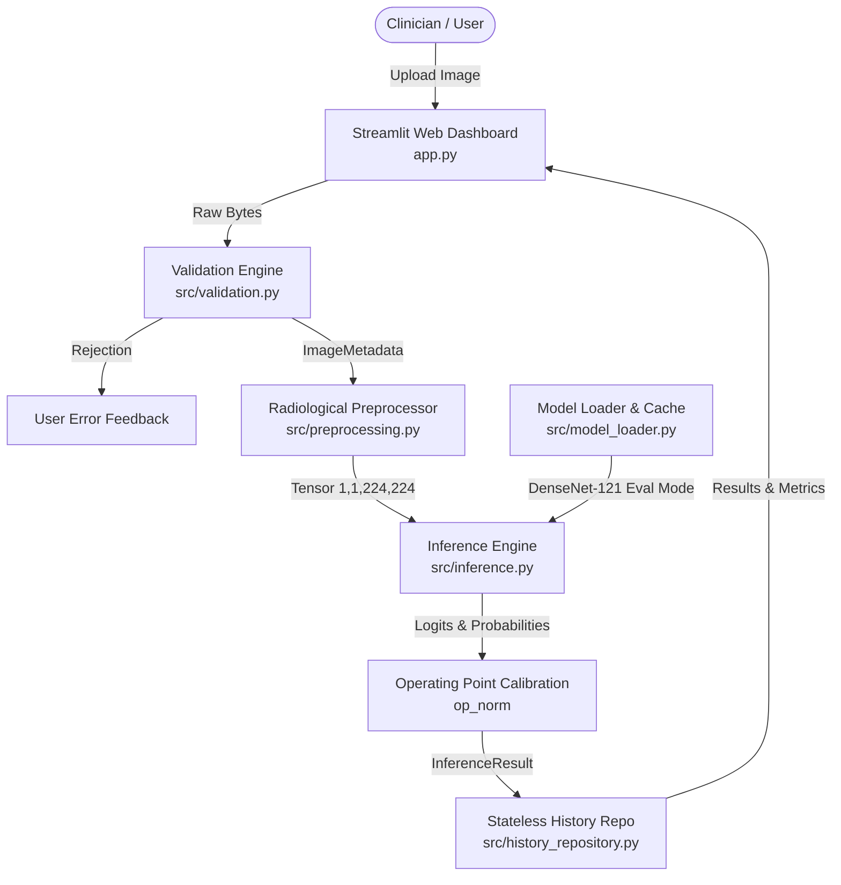

# 🩻 Medical Vision AI — Chest Radiography Classification POC

A production-structured, end-to-end Computer Vision proof-of-concept demonstrating **real deep learning inference** on frontal chest X-rays using a medically pretrained **DenseNet-121** model.

> [!WARNING]
> **RESEARCH & PORTFOLIO DEMONSTRATION ONLY — NOT FOR CLINICAL USE**  
> This application is an educational prototype and portfolio demonstration for AI development. It has not undergone clinical validation, is not certified as a medical device (CE/FDA), and **must never be used to diagnose, guide, or manage clinical conditions**.

---

## 📑 Table of Contents
- [Overview](#overview)
- [Key Features](#key-features)
- [System Architecture](#system-architecture)
- [Verified Model Details](#verified-model-details)
- [Supported Pathologies](#supported-pathologies)
- [Technology Stack](#technology-stack)
- [Installation & Setup](#installation--setup)
- [Running the Application](#running-the-application)
- [Automated Testing](#automated-testing)
- [Smoke Test & Actual Benchmark Results](#smoke-test--actual-benchmark-results)
- [Inference Pipeline Specification](#inference-pipeline-specification)
- [Evaluation & Methodology](#evaluation--methodology)
- [Privacy & Security](#privacy--security)
- [Future Production Enhancements](#future-production-enhancements)
- [Portfolio Demo Recording Checklist](#portfolio-demo-recording-checklist)
- [License](#license)

---

## Overview

Unlike dashboard-only mockups or toy ImageNet models, **Medical Vision AI** executes actual deep learning inference using **TorchXRayVision**, a peer-reviewed radiological library developed by Joseph Paul Cohen et al. (Stanford / Mila / Harvard).

The model was pretrained on multi-institution medical datasets (NIH ChestX-ray14, CheXpert, PadChest, MIMIC-CXR, OpenI) across hundreds of thousands of chest radiographs, enabling real detection across **18 distinct cardiopulmonary pathologies**.

---

## Key Features

- **Real Deep Learning Inference**: 100% real PyTorch forward-pass execution. No simulated predictions, fake confidence scores, or mock pipelines.
- **Scientifically Sound Calibration**: Distinguishes raw classifier logits, sigmoid probabilities, and threshold-calibrated scores based on operating points calculated across validation cohorts.
- **Strict Input Validation**: Rejects corrupted files, unsupported MIME types, out-of-boundary dimensions, and oversized payloads.
- **Radiological Preprocessing**: Implements exact radiological normalization (`[-1024, 1024]` intensity scaling and bilinear antialiased resampling).
- **Stateless & Privacy-Compliant**: Keeps images in ephemeral memory; no patient data or images are written to persistent storage.
- **Modular Architecture**: Clean separation between configuration, validation, preprocessing, model loading, inference, and persistence.
- **Automated Verification**: Complete test suite (21 tests) covering unit validation, preprocessing, model loading, and end-to-end integration.

---

## System Architecture



---

## Verified Model Details

| Attribute | Specification |
|---|---|
| **Architecture** | DenseNet-121 (`torchxrayvision.models.DenseNet`) |
| **Weights Identifier** | `densenet121-res224-all` |
| **Provider** | [TorchXRayVision](https://github.com/mlmed/torchxrayvision) (v1.5.5) |
| **Citation** | Cohen et al., *TorchXRayVision: A library of chest X-ray datasets and models*, MIDL / Scientific Data (2022) |
| **License** | Apache License 2.0 |
| **Pretraining Datasets** | NIH ChestX-ray14, CheXpert (Stanford), PadChest (Univ. Alicante), MIMIC-CXR (MIT/BIDMC), Google OpenI, RSNA Kaggle |
| **Input Shape** | `(1, 1, 224, 224)` (Single-channel grayscale) |
| **Normalization Range** | `[-1024.0, 1024.0]` via `xrv.datasets.normalize(img, 255)` |
| **Download Size** | ~28 MB (`.pt` PyTorch weights) |
| **Execution Hardware** | CPU (Intel Core i7 / laptop standard) or CUDA GPU |

---

## Supported Pathologies

The model outputs predictions across **18 distinct thoracic conditions**:

1. **Cardiomegaly**
2. **Atelectasis**
3. **Consolidation**
4. **Infiltration**
5. **Pneumothorax**
6. **Edema**
7. **Emphysema**
8. **Fibrosis**
9. **Effusion**
10. **Pneumonia**
11. **Pleural Thickening**
12. **Nodule**
13. **Mass**
14. **Hernia**
15. **Lung Lesion**
16. **Fracture**
17. **Lung Opacity**
18. **Enlarged Cardiomediastinum**

---

## Technology Stack

- **Language**: Python 3.10+ (tested on Python 3.14)
- **Deep Learning Framework**: PyTorch 2.x & Torchvision (CPU build)
- **Computer Vision Library**: TorchXRayVision 1.5.5
- **Image Processing**: Pillow (PIL), NumPy, SciPy, scikit-image
- **Web Interface**: Streamlit 1.x
- **Schema & Validation**: Pydantic v2
- **Configuration Management**: PyYAML
- **Automated Testing**: pytest 9.x

---

## Installation & Setup

### 1. Clone Repository & Setup Virtual Environment
```bash
git clone https://github.com/<your-username>/medical-vision-ai.git
cd medical-vision-ai

# Create virtual environment
python3 -m venv .venv

# Activate virtual environment
source .venv/bin/activate
```

### 2. Install Verified Dependencies
```bash
# Install PyTorch CPU wheels and project dependencies
pip install --upgrade pip
pip install -r requirements.txt
```

### 3. Automatic Weights Download
Model weights (~28 MB) are automatically fetched on the first run and cached in `~/.torchxrayvision/models_data/`.

If working in an offline environment, manually download the weights:
```bash
mkdir -p ~/.torchxrayvision/models_data
wget https://github.com/mlmed/torchxrayvision/releases/download/v1/nih-pc-chex-mimic_ch-google-openi-kaggle-densenet121-d121-tw-lr001-rot45-tr15-sc15-seed0-best.pt \
     -O ~/.torchxrayvision/models_data/nih-pc-chex-mimic_ch-google-openi-kaggle-densenet121-d121-tw-lr001-rot45-tr15-sc15-seed0-best.pt
```

---

## Running the Application

Launch the Streamlit web dashboard:
```bash
streamlit run app.py
```

The application will be accessible at `http://localhost:8501`.

---

## Automated Testing

Run the full automated test suite using `pytest`:
```bash
pytest -v
```

### Test Suite Coverage:
- `tests/test_validation.py`: PNG/JPEG validation, corrupt uploads, invalid extensions, empty files, dimension boundaries.
- `tests/test_preprocessing.py`: Grayscale conversion, dynamic range normalization (`[-1024, 1024]`), tensor shapes.
- `tests/test_model_loader.py`: Real model instantiation, eval mode enforcement, gradient freezing, in-memory caching.
- `tests/test_inference.py`: Score calculations, schema validation, latency measurement, error handling.
- `tests/test_history_repository.py`: In-memory and SQLite repository behavior.
- `tests/test_integration_real_model.py`: End-to-end integration test with real NIH chest radiograph.

---

## Smoke Test & Actual Benchmark Results

Execute the standalone smoke test to verify model loading, preprocessing, and real inference:
```bash
python smoke_test.py
```

### Actual Output on Official NIH Test Radiograph (`00000001_000.png`):
```text
======================================================================
 Medical Vision AI - Real Model Inference Smoke Test
======================================================================

[1/5] Loading configuration...
  Model Architecture : TorchXRayVision DenseNet-121 (densenet121)
  Pretrained Weights : densenet121-res224-all
  Target Device      : cpu

[2/5] Loading verified medical model...
  Model loaded in    : 218.9 ms
  Supported Classes  : 18 pathologies

[3/5] Validating test chest X-ray: nih_cardiomegaly_sample.png
  Image dimensions   : 512x512 (PNG, 178.3 KB)

[4/5] Preprocessing image to TorchXRayVision standard...
  Tensor shape       : (1, 1, 224, 224)
  Intensity range    : [-1024.0, 1003.8] (normalized to [-1024, 1024])

[5/5] Running actual model inference (torch.no_grad, eval mode)...

Inference completed in: 128.0 ms
Analysis ID: ana_b3d2a5b12448

Top Predicted Pathologies:
---------------------------------------------------------------------------
Pathology                  | Calibrated | Prob     | Threshold | Status
---------------------------------------------------------------------------
Cardiomegaly               | 60.7%      | 0.2533   | 0.0503    | DETECTED (>thresh)
Fibrosis                   | 54.1%      | 0.0913   | 0.0101    | DETECTED (>thresh)
Infiltration               | 52.2%      | 0.1383   | 0.0981    | DETECTED (>thresh)
Pleural_Thickening         | 51.1%      | 0.0474   | 0.0268    | DETECTED (>thresh)
Nodule                     | 50.9%      | 0.0412   | 0.0240    | DETECTED (>thresh)
---------------------------------------------------------------------------

 SMOKE TEST PASSED: Verified actual model inference correctly identified ground-truth pathology.
```

---

## Inference Pipeline Specification

For complete mathematical definitions and step-by-step pipeline execution, see [docs/inference_pipeline.md](docs/inference_pipeline.md).

```text
Upload (PNG/JPEG)
  ↳ Validation (Header verify, dimension bounds, size limits)
    ↳ Radiological Preprocessing (Luminance → [-1024, 1024] norm → 224x224 resample)
      ↳ Model Forward Pass (DenseNet-121 features2 + classifier head)
        ↳ Logit Extraction & Sigmoid Probabilities
          ↳ Operating Point Normalization (op_norm scaling)
            ↳ Ephemeral In-Memory Persistence
              ↳ Clinical Dashboard Presentation
```

---

## Evaluation & Methodology

1. **Pretrained Baseline**: The POC uses weights trained and validated across major public cohorts ([NIH ChestX-ray14](https://nihcc.app.box.com/v/ChestXray-Nihcc), [Stanford CheXpert](https://aimi.stanford.edu/datasets/chexpert-chest-x-rays), PadChest, and MIMIC-CXR).
2. **Score Calibration**: Because multi-label clinical datasets exhibit strong class imbalance (e.g. pneumothorax prevalence vs. normal), raw sigmoid probabilities cannot be interpreted directly as diagnostic probabilities. The model uses pre-computed operating points ($\tau_i$) to produce normalized calibrated scores where 50% represents the operating decision boundary.
3. **Independent Validation**: Because this proof-of-concept operates without a separate clinical evaluation split, external diagnostic performance has not been independently verified.

---

## Privacy & Security

- **Zero Disk Retention**: Uploaded image bytes are processed entirely in volatile memory (`io.BytesIO`) and discarded after garbage collection.
- **Zero PII**: No patient names, MRNs, dates of birth, or metadata are ingested or stored.
- **Local Execution**: Inference executes 100% locally on CPU without making external API calls or transmitting images to third-party cloud services.

---

## Future Production Enhancements

This POC was engineered modularly to serve as the foundation for enterprise medical AI deployments:
- **DICOM / PACS Ingestion**: Integrate `pydicom` to support 16-bit DICOM `.dcm` files and DICOMweb protocols (WADO-RS / STOW-RS).
- **Explainability (Grad-CAM)**: Generate Class Activation Maps to localize anatomical regions driving pathology predictions.
- **Production Backend**: Decouple the UI into a dedicated FastAPI microservice with asynchronous task workers (Celery / Redis).
- **Relational History Persistence**: Enable `SQLiteHistoryRepository` or PostgreSQL backend with encrypted metadata storage.
- **Model Ensembling**: Combine DenseNet-121 with ResNet-50 and Vision Transformer architectures for consensus scoring.

---

## Portfolio Demo Recording Checklist

When recording a 2–3 minute Loom or video demo for prospective clients:
1. **Show the Problem & Objective**: Mention that this is a dedicated computer vision application implementing real deep learning on medical radiographs.
2. **Review Model Provenance**: Open the sidebar model card to show the verified TorchXRayVision DenseNet-121 architecture and pretraining sources.
3. **Demonstrate Real Inference**:
   - Select the bundled NIH Cardiomegaly sample or upload a fresh chest X-ray.
   - Click "Analyze Chest X-ray".
   - Highlight the sub-second execution latency (~120ms on CPU).
4. **Explain Score Calibration**: Point out the distinction between raw logits, sigmoid probabilities, and calibrated scores (explaining operating points).
5. **Show Diagnostic Matrix**: Expand the 18-pathology diagnostic table to prove all classes are evaluated.
6. **Highlight Architecture & Clean Code**: Show the modular repo structure (`src/inference.py`, `src/preprocessing.py`, `tests/`), run `pytest` in terminal to show 21 passing automated tests.

---

## License

This project is licensed under the Apache License 2.0.
Model weights are provided by TorchXRayVision under Apache 2.0.
