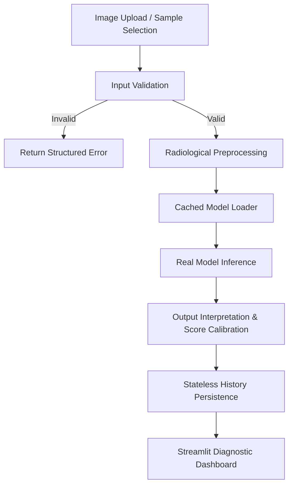

# Technical Architecture: Inference Pipeline Specification

This document details the end-to-end dataflow and technical mechanics of the **Medical Vision AI** inference pipeline.

---

## 1. High-Level Flowchart

---

## 2. Pipeline Stages

### Stage 1: Upload & Ingestion
- **Input Types**: `PNG`, `JPEG` images via Streamlit file uploader or local sample images from `data/sample_images/`.
- **Memory Handling**: Kept strictly as in-memory byte buffers (`io.BytesIO`). No raw medical images are saved to disk.

### Stage 2: Validation (`src/validation.py`)
Checks executed before invoking tensor operations:
1. **Byte-level Check**: Ensures payload is non-empty (`> 0` bytes).
2. **File Size Enforcement**: Enforces `len(data) <= 10MB`.
3. **Format & Suffix Filter**: Case-insensitive extension check against allowed formats (`.png`, `.jpg`, `.jpeg`).
4. **Structural & Raster Integrity**:
   - `Image.open().verify()` checks header structure.
   - `Image.open().load()` decodes raster scanlines, preventing decompression bombs and corrupt streams.
5. **Dimensional Boundaries**: Width and height must be within `[64, 4096]` pixels.

### Stage 3: Radiological Preprocessing (`src/preprocessing.py`)
Transforms standard 8-bit web images into radiological tensors matching **TorchXRayVision** standards:
1. **Luminance Conversion**: Converts multi-channel (RGB/RGBA) scans into 2D float32 grayscale representations (`convert("L")` / single plane).
2. **Dynamic Range Normalization**:
   $$\text{Normalized} = \text{xrv.datasets.normalize}(\text{pixel\_array}, \text{maxval}=255.0)$$
   Maps 8-bit range $[0, 255]$ into $[-1024.0, 1024.0]$, matching CT Hounsfield / radiographic scale.
3. **Tensor Construction**: Constructs 4D tensor with shape `(Batch=1, Channels=1, Height, Width)`.
4. **Spatial Resampling**: Bilinear interpolation with antialiasing resizes image to $(224, 224)$.

### Stage 4: Verified Model Inference (`src/inference.py` & `src/model_loader.py`)
1. **Architecture**: Pretrained **DenseNet-121** (`densenet121-res224-all`) sourced from `torchxrayvision` (Apache 2.0).
2. **Evaluation Mode**: `model.eval()` disables dropout and freezes BatchNorm statistics.
3. **Gradients Disabled**: Evaluated inside `with torch.no_grad():` block.
4. **Timing**: Measured with high-resolution monotonic clock (`time.perf_counter()`).
5. **Feature Extraction & Classification**:
   $$\text{features} = \text{model.features2}(x)$$
   $$\text{logits} = \text{model.classifier}(\text{features})$$

### Stage 5: Output Interpretation & Operating Point Calibration
1. **Raw Logits**: Unbounded real numbers $\in (-\infty, +\infty)$ directly from the linear head.
2. **Sigmoid Probabilities**: Multi-label Bernoulli output:
   $$P_i = \sigma(z_i) = \frac{1}{1 + e^{-z_i}}$$
3. **Operating Thresholds ($\tau_i$)**: Pre-computed operating thresholds stored in `model.op_threshs`.
4. **Calibrated Operating Scores ($S_i$)**:
   $$\text{If } P_i \le \tau_i: \quad S_i = \frac{P_i}{2 \cdot \tau_i}$$
   $$\text{If } P_i > \tau_i: \quad S_i = 1.0 - \frac{1.0 - P_i}{2 \cdot (1.0 - \tau_i)}$$
   - $S_i = 0.5$ represents the exact operating decision point for that pathology.
   - $S_i \ge 0.5$ triggers positive detection (`is_detected = True`).

### Stage 6: Stateless Persistence (`src/history_repository.py`)
- Employs an `InMemoryHistoryRepository` during the demo session.
- Stores execution metadata (Analysis ID, UTC timestamp, latency, scores, top finding) exclusively in RAM.
- Ensures zero patient data or medical image bytes are retained on disk.
- SQLite backend is provided and tested for future production database extensions.

### Stage 7: Presentation (`app.py`)
- Renders primary findings, execution latency, and full 18-pathology diagnostic table.
- Interactive distribution charts powered by Altair/Streamlit.
- Prominent research and portfolio disclaimers.
